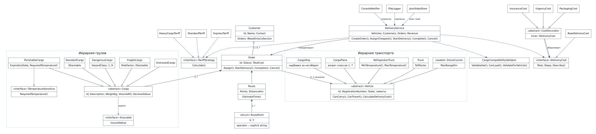

# ООП - выполнил Кабиров Данияр

Лабораторная по ООП на C# для транспортно логистической компании LogiCore. Программа принимает заказы, проверяет грузы, выбирает транспорт, считает стоимость и сохраняет данные в json. Выполнено всё c T1 по T10 и E3 из экспертных пунктов, восстановление точных типов грузов и транспорта из json
## Запуск

Я делал всё на .NET SDK 10.0 в Rider.

Запуск в Rider:

В Rider надо открыть LabOOP.sln, выбпать конфиг LabOOP и нажать Run. Сначала без ввода выполняется демонстрация демки, а потом открывается меню.

Для запуска тестов нажать правой кнопкой на проект LogiCore.Tests и выбрать Run Unit Tests.

Запуск через терминал:
Если команда dotnet доступна, выполнить из папки решения:

```bash
dotnet run --project LogiCore.App
```
Отдельно можно собрать решение и запустить тесты:
```bash
dotnet build LabOOP.sln -c Release
dotnet test LabOOP.sln -c Release
```

## Структура

| Проект | Что в нём находится |
|---|---|
| LogiCore.Domain | Модель, правила совместимости, диспетчер, стоимость, отчёты и json хранилище |
| LogiCore.App | Демонстрация, меню, вывод в консоль и файловый журнал |
| LogiCore.Tests | Тесты xUnit для доменной модели и сервисов |

Program только запускает ConsoleApplication. Доменная библиотека не обращается к Console. В ней отдельно выделены проверка грузов, диспетчер, расчёт стоимости, отчёты и хранение данных.

Грузы заказа и история клиента отдаются через оболочки только для чтения. Изменять статус заказа можно только методами Assign, StartDelivery, Complete и Cancel.

## Демонстрация и меню

При запуске программа сначала показывает демо. Создаются 6 транспортных средств пяти типов и 12 грузов всех видов. Потом программа пробует оформить заказ с опасным и скоропортящимся грузом вместе. Такой заказ не принимается. Ещё одна проверка - попытка загрузить в дрон слишком тяжёлый груз. При этом срабатывает `VehicleOverloadAttempt`

Для первого заказа рассчитывается цена с тарифом и тремя дополнительными услугами. Все суммы выводятся по шагам. Дальше показано, как завершить доставку, отменить заказ до отпрваки и что будет при попытке выполнить недоступное действие. События выводятся в консоль через `ConsoleNotifier` и записываются в файл через `FileLogger`. Также есть пример отписки обработчика через `-=`

После этого выводятся шесть отчётов. Программа сохраняет данные в JSON, очищает их из памяти и загружает обратно. Результаты до и после загрузки сравниваются. Выручка в демо получается 40306.5 руб. Один заказ специально остаётся в пути, чтобы проверить восстановление занятого транспорта.

После демо открывается меню. В нём можно создать заказ, посмотреть отчёты, сохранить или загрузить данные. Для заказа можно выбрать транспорт, начать и завершить доставку либо отменить его до отправки

Файлы сохраняются в папку `data`: журнал - в `delivery.log`, данные демо - в `demo-state.json`, а сохранение из меню - в `state.json`. Демо не перезаписывает сохранение из меню. В Rider папка `data` создаётся внутри решения. При запуске из другого места она появится в текущей рабочей папке. Чтобы сохранить свои данные, нужно выбрать соответствующий пункт меню.

## Принятые правила

Маршрут задан точками на плоскости в километрах, время считается без остановок и погрузки

В рефрижераторе одна камера, поэтому все грузы в заказе должны требовать одинаковую температуру

Транспорт становится занятым сразу после назначения, статус `InTransit` означает резерв или движение

В выручку входят только доставленные заказы

## Расчёт стоимости

Сначала выбирается свободный транспорт, который подходит по маршруту, массе, объёму и составу груза. Среди подходящих выбирается минимальная собственная стоимость. При равной цене порядок определяется номером ТС. Птом применяются тариф и выбранные услуги.

| Транспорт | Формула до тарифа и услуг |
|---|---|
| Truck | км * 40 * 1,15 |
| RefrigeratorTruck | км * 55 * 1,2 |
| CargoPlane | км * 250 + кг * 12 |
| CargoShip | км * 15 + 3500 за каждое негабаритное место |
| DroneCourier | км * 8 + кг * 5, максимум 5 кг и 25 км |

StandardTariff оставляет сумму без изменения. ExpressTariff умножает её на 1.4. HeavyCargoTariff добавляет 2 руб. за каждый килограмм сверх 10 000 кг.

Услуги применяются в порядке страховка, срочность, упаковка. Страховка равна 1% объявленной стоимости, для хрупких грузов дополнительно учитывается коэффициент риска. Срочность умножает текущую сумму на 1.25. Упаковка стоит 700 руб. за каждое хрупкое место. Коэффициенты находятся в TariffSettings, а коэффициенты транспортных формул имеют имена.

Декораторы зависят от порядка: `(100 + 20) * 1.25 + 700 = 850`, а `(100 + 20 + 700) * 1.25 = 1025`. В итоге стоимость заказа округляется до копеек при назначении


## Соответствие заданию

Пути указаны относительно папки решения.

| Требование | Где выполнено |
|---|---|
| T1 - инкапсуляция | `LogiCore.Domain/Cargo.cs`, `Vehicle.cs`, `Order.cs`: проверки данных, закрытые сеттеры и коллекции только для чтения |
| T2 - наследование | `LogiCore.Domain/Vehicle.cs`: `abstract`, `virtual`, `override`, `base.CanCarry` и `sealed DroneCourier`. В `Cargo.cs` находятся пять видов грузов |
| T3 - интерфейсы и вариантность | `LogiCore.Domain/Common/Contracts.cs`, `LogiCore.Domain/Pricing.cs`. Явная реализация интерфейса находится в `Cargo.cs`, примеры вариантности - в `LogiCore.App/DemoScenario.cs` |
| T4 - обобщения и коллекция | `LogiCore.Domain/Common/Repository.cs`: ограничения типа, добавление, удаление, поиск, индексатор, `yield return` и метод расширения |
| T5 - события | `LogiCore.Domain/Services/Events.cs`, `DeliveryService.cs`: четыре события, свои `EventArgs` и делегат. Подписчики - `LogiCore.App/Notifications.cs`, отписка - `DemoScenario.cs` |
| T6 - исключения | `LogiCore.Domain/Common/Exceptions.cs`: собственная иерархия исключений. `when`, `throw`, `using` и `finally` используются в `JsonStateStore.cs` и приложении |
| T7 - паттерны | Strategy, Decorator и Singleton - `LogiCore.Domain/Pricing.cs`, Factory Method - `VehicleFactory.cs`, Observer - события диспетчера |
| T8 - LINQ | `LogiCore.Domain/ReportService.cs`: шесть отчётов, запрос `from/select`, фильтрация, сортировка, группировка, `Join`, агрегаты и словарь |
| T9 - JSON | `LogiCore.Domain/JsonStateStore.cs`: сохранение и загрузка транспорта, клиентов и заказов, обработка ошибок файла. Очистка памяти и повторный отчёт - `LogiCore.App/ConsoleApplication.cs` |
| T10 - enum и struct | `LogiCore.Domain/Vehicle.cs`: `[Flags]`. `Route.cs`: структура `RoutePoint`, оператор расстояния и преобразование в строку. Побитовые операции - `LogiCore.App/DemoScenario.cs` |
| E3 - полиморфная сериализация | `LogiCore.Domain/Cargo.cs`, `Vehicle.cs`, `JsonStateStore.cs`: сохранение и восстановление точных типов и связей между объектами |

## Паттерны

| Паттерн | Где и зачем |
|---|---|
| Strategy | `ITariffStrategy` и три тарифа позволяют менять формулу без изменения диспетчера |
| Decorator | Страховка, срочность и упаковка добавляются к стоимости отдельными декораторами |
| Factory Method | Наследники `VehicleFactory` создают разные виды транспорта через метод `Create` |
| Observer | Консоль и файловый журнал независимо получают события диспетчера |
| Singleton | `TariffSettings.Instance` хранит общие настройки, экземпляр создаётся через `Lazy<T>` |

## SOLID

S: проверка грузов, отчёты и сохранение находятся в отдельных классах

O: новый транспорт добавляется через наследование от `Vehicle`, подбор в диспетчере менять не нужно 

L: все виды транспорта работают через общий контракт `Vehicle`

I: температура, страховка и возможность ставить грузы дург на друга описаны отдельными интерфейсами

D: расчёт использует `ITariffStrategy` и `IDeliveryCost`, диспетчер не зависит от консоли и журнала

## Тесты

В проекте 52 тестовых случая xUnit. Проверяются расчёты стоимости, ограничения грузов, статусы заказов, события, репозиторий, декораторы, отчёты и сохранение с последующей загрузкой json

## UML

Диаграмма классов - `docs/classes.svg`, исходник - `docs/classes.dot`
